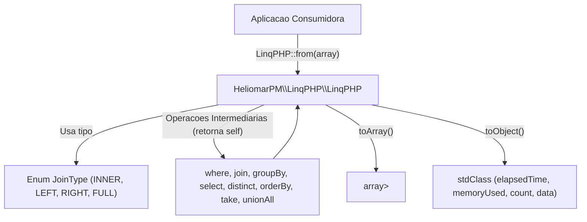

# Arquitetura do Sistema: LinqPHP

> Gerado por -discovery | Commit base: `b7da27a` | Atualizado em: 2026-10-13 | Idioma: pt-BR

<!-- discovery:start:estilo -->
## Estilo arquitetural
Biblioteca monolitica leve orientada a objetos com padrao DSL Fluida (Fluent Interface / Builder-like) para transformacao in-memory de arrays tabulares. O ciclo de vida compreende:
1. Ponto de entrada estatico (`LinqPHP::from($data)`) ou construtor.
2. Encadeamento de operacoes intermediarias (`where`, `join`, `groupBy`, `select`, `distinct`, `orderBy`, `take`, `unionAll`).
3. Operacoes de saida e terminalizacao (`toArray()`, `toObject()`).
<!-- discovery:end:estilo -->

<!-- discovery:start:diagrama -->
## Diagrama de componentes

<!-- discovery:end:diagrama -->

<!-- discovery:start:modulos -->
## Modulos do repositorio

| Modulo / Pasta | Responsabilidade | Dependencias |
| :--- | :--- | :--- |
| `src/` | Nucleo da biblioteca (`LinqPHP.php`, classe principal e enum `JoinType`) | Nenhuma (PHP nativo) |
| `tests/Unit/` | Testes unitarios isolados para cada metodo (`WhereTest`, `JoinTest`, `GroupByTest`, etc.) | PHPUnit 13 |
| `tests/Integration/` | Testes de fluxo completo combinando multiplas operacoes (`LinqFlowTest`) | PHPUnit 13 |
| `benchmarks/` | Suite proprietaria e benchmarks do PHPBench para estresse de throughput e memoria | PHPBench, LinqPHP |
| `demo/` | Aplicacao de demonstracao pratica com dashboard analitico (`demo/dashboard.php`) | LinqPHP |
| `docs/` | Guias de comunidade (`CONTRIBUTING.md`, `CODE_OF_CONDUCT.md`, `SUPPORT.md`) | Nenhuma |
<!-- discovery:end:modulos -->

<!-- discovery:start:fluxo -->
## Fluxo de execucao principal
1. **Entrada e Validacao**: `LinqPHP::from($data)` instancia a classe, grava tempo e memoria iniciais e executa `assertJsonCollection()`, validando se os dados sao um array e se este e indexado (`array_is_list`).
2. **Transformacao em Cadeia**: cada operacao modifica internamente o array `$this->data` e retorna `$this`.
3. **Joins**: utiliza hash maps baseados nas chaves de relacionamento para busca eficiente O(N+M) em `join()` (INNER, LEFT, RIGHT, FULL).
4. **Agrupamentos e Agregacoes**: `groupBy()` indexa os registros por chaves de grupo e aplica agregacoes predefinidas (`sum`, `count`, `avg`, `min`, `max`).
5. **Terminalizacao**: `toArray()` entrega o array final modificado; `toObject()` calcula tempo decorrido (`microtime`) e memoria consumida (`memory_get_usage`), retornando uma `stdClass`.
<!-- discovery:end:fluxo -->

<!-- discovery:start:riscos -->
## Riscos arquiteturais observados
- **Mutabilidade Interna**: a classe altera seu estado interno (`$this->data`) ao inves de produzir instancias imutaveis. O reuso da mesma variavel em diferentes cadeias pode causar efeitos colaterais.
- **Validacao de Linhas Comentada**: em `src/LinqPHP.php`, a checagem individual de se cada item do array e um array associativo esta comentada (`// foreach ...`), priorizando performance mas permitindo que arrays com itens heterogeneos cheguem as operacoes.
<!-- discovery:end:riscos -->
