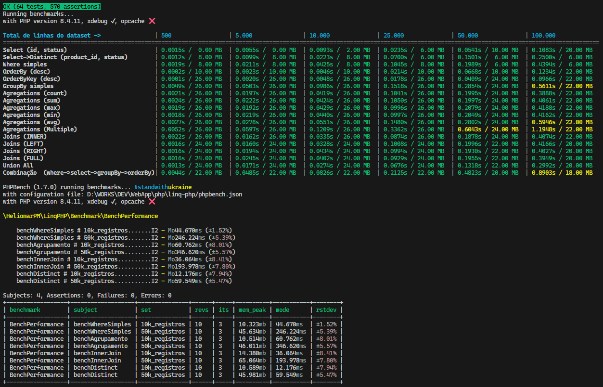

<div id="top" align="center">
<h1>
  

  <a href="https://navto.me/heliomarpm" target="_blank"></a>
  
  [![CodeFactor][url-codefactor-badge]][url-codefactor]	
  [![Packagist Version][url-packagist-badge]][url-packagist]
  [![Packagist Downloads][url-packagist-downloads-badge]][url-packagist]
</h1>

<div class="badges">

  [![GitHub Sponsors][url-github-sponsors-badge]][url-github-sponsors]
  [![PayPal][url-paypal-badge]][url-paypal]
  [![Ko-fi][url-kofi-badge]][url-kofi]
  [![Liberapay][url-liberapay-badge]][url-liberapay]
  
</div>
</div>

LinqPHP é uma biblioteca leve, de alta performance e sem dependências externas para manipulação de coleções de dados (`arrays`) em PHP, inspirada na sintaxe do LINQ (Language Integrated Query).

Permite filtrar, agrupar, ordenar e unir arrays multidimensionais de forma fluida e elegante, sendo ideal para processamento de relatórios, formatação de dados para APIs e refatoração de sistemas legados.

> [Demo interativo](https://linq-php.vercel.app/)

### Benchmark



## Requisitos

- PHP 8.1 ou superior.

## Instalação

Você pode instalar o pacote via Composer:

```bash
composer require heliomarpm/linq-php
```

## Como usar

A classe LinqPHP utiliza uma interface fluida (method chaining). Todas as operações retornam a própria instância (exceto os métodos de saída `toArray` e `toObject`), permitindo encadear múltiplas transformações.

### Inicialização

```php
require 'vendor/autoload.php';

use HeliomarPM\LinqPHP\LinqPHP;

$data = [
  ['id' => 1, 'name' => 'John', 'age' => 25, 'status' => 'active', 'city' => 'London'],
  ['id' => 2, 'name' => 'Jane', 'age' => 30, 'status' => 'pending', 'city' => 'New York'],
  ['id' => 3, 'name' => 'John', 'age' => 35, 'status' => 'inactive', 'city' => 'Paris'],
];

$linq = LinqPHP::from($data);

```

#### 💡 Dica (Uso Opcional): Consultando dados do Banco de Dados com DbPHP

Para extrair dados do MySQL, SQLite ou PostgreSQL com alta performance, zero dependências e telemetria nativa, utilize a biblioteca parceira [heliomarpm/db-php](https://github.com/heliomarpm/db-php) ([Demo interativa](https://db-php.vercel.app/)):

```bash
composer require heliomarpm/db-php
```

O método `->linq()` do **DbPHP** integra-se perfeitamente ao **LinqPHP**, permitindo encadear filtros e transformações em memória direto da query SQL:

```php
use HeliomarPM\DbPHP\DB;

// Consulta o banco e continua o pipeline diretamente no LinqPHP via ->linq():
$ativos = DB::query("SELECT id, nome, limite_credito, status FROM clientes WHERE status = :status", ["status" => "ativo"])
    ->linq()
    ->where(fn($c) => $c['limite_credito'] > 1000)
    ->orderByKey('nome')
    ->toArray();
```

---

### `where()` - Filtragem de Dados

Aceita arrays de condições simples ou funções (closures) para filtros complexos.

```php
// Filtro simples
$result = LinqPHP::from($data)
    ->where(['age', '>', 25])
    ->toArray();

// Múltiplos filtros e operadores (startswith, endswith, contains, in)
$result = LinqPHP::from($data)
    ->where([
        ['age', '>=', 25],
        ['status', 'in', ['active', 'pending']],
        ['name', 'startswith', 'J']
    ])
    ->toArray();

// Usando Closures (funções anônimas)
$result = LinqPHP::from($data)
    ->where(fn($item) => $item['id'] % 2 !== 0)
    ->toArray();
```

### `select()` e `distinct()` - Projeção de Dados

Selecione apenas as colunas desejadas, renomeie campos utilizando aliases ou misture ambos com a projeção híbrida.

```php
// 1. Seleção simples de colunas
$result = LinqPHP::from($data)
    ->select(['name', 'status'])
    ->toArray();

// 2. Seleção com Aliases (renomeação de colunas)
$result = LinqPHP::from($data)
    ->select([
        'id'   => 'codigo',
        'name' => 'nome_completo',
        'city' => 'cidade'
    ])
    ->toArray();

// 3. Projeção Híbrida (mantém alguns campos originais e renomeia outros)
$result = LinqPHP::from($data)
    ->select([
        'id',                      // mantém como 'id'
        'name' => 'nome_completo', // renomeia para 'nome_completo'
        'status'                   // mantém como 'status'
    ])
    ->toArray();

// 4. Retorna apenas os registros únicos
$result = LinqPHP::from($data)
    ->select(['name'])
    ->distinct()
    ->toArray();
```

> [!TIP]
> **Performance e Modo Estrito (`strict`)**:
> - **Zero Performance Penalty**: Em seleções tradicionais indexadas numericamente (`['name', 'status']`), o LinqPHP utiliza internamente `array_is_list()` nativo do PHP 8.1+ e executa o caminho direto em C com `array_intersect_key`, garantindo **zero degradação de performance**.
> - **Preservação de Ordem**: As colunas no array de saída seguem rigorosamente a ordem em que foram declaradas no `select()`.
> - **Modo Estrito**: Por padrão (`strict: false`), campos inexistentes na fonte são preenchidos com `null`. Ao usar `select(['campo1', 'campo2'], strict: true)`, uma `InvalidArgumentException` será lançada caso alguma chave não exista no registro.

### `join()` - União Relacional

Faça uniões relacionais entre arrays multidimensionais como se estivesse em um banco de dados relacional. Suporta os 4 tipos de join via métodos dedicados e expressivos (`innerJoin`, `leftJoin`, `rightJoin`, `fullJoin`) ou pelo método genérico `join()` com o enum nativo `JoinType`:

- `innerJoin()` ou `JoinType::INNER`: Retorna apenas os registros com correspondência em ambas as coleções.
- `leftJoin()` ou `JoinType::LEFT`: Retorna todos os registros da esquerda e os correspondentes da direita (ou `null`).
- `rightJoin()` ou `JoinType::RIGHT`: Retorna todos os registros da direita e os correspondentes da esquerda (ou `null`).
- `fullJoin()` ou `JoinType::FULL`: Retorna todos os registros de ambos os lados, preenchendo lacunas com `null`.

```php
$users = [
    ['id' => 1, 'name' => 'John', 'course_id' => 10],
    ['id' => 2, 'name' => 'Jane', 'course_id' => 20],
];

$courses = [
    ['id_course' => 10, 'course_name' => 'PHP 8'],
    ['id_course' => 20, 'course_name' => 'Clean Code'],
];

// Métodos diretos e fluidos (dispensam a importação de JoinType)
$result = LinqPHP::from($users)
    ->innerJoin($courses, ['course_id' => 'id_course'])
    ->toArray();

$result = LinqPHP::from($users)
    ->leftJoin($courses, ['course_id' => 'id_course'])
    ->toArray();

// Joins Múltiplos encadeados (Join Triplo)
$result = LinqPHP::from($vendas)
    ->innerJoin($produtos, ['produto_id' => 'id_produto'])
    ->leftJoin($clientes, ['cliente_id' => 'id_cliente'])
    ->toArray();

// Método genérico com o enum JoinType (ideal para tipos de join dinâmicos)
use HeliomarPM\LinqPHP\JoinType;

$result = LinqPHP::from($users)
    ->join($courses, JoinType::INNER, ['course_id' => 'id_course'])
    ->toArray();
```


### `unionAll()` - Concatenação de Coleções

Consolida múltiplos arrays em uma única coleção, preenchendo automaticamente com `null` colunas ausentes em registros heterogêneos.

```php
$produtosRegulares = [
    ['id' => 1, 'nome' => 'Filamento PLA', 'preco' => 90.0]
];

$produtosOutlet = [
    ['id' => 2, 'nome' => 'Resina 3D', 'desconto' => 0.2] // coluna 'preco' ausente
];

$result = LinqPHP::from($produtosRegulares)
    ->unionAll($produtosOutlet)
    ->toArray();
```

### `groupBy()` - Agrupamento e Agregação

Agrupe dados e realize cálculos automáticos (`sum`, `max`, `min`, `count`, `avg`).

```php
$vendas = [
    ['vendedor' => 'João', 'valor' => 100],
    ['vendedor' => 'Maria', 'valor' => 200],
    ['vendedor' => 'João', 'valor' => 150],
];

// Agrupa por vendedor e soma os valores
$result = LinqPHP::from($vendas)
    ->groupBy(['vendedor'], ['sum' => ['valor']])
    ->toArray();
```

### `orderBy()` e `orderByKey()` - Ordenação

Ordene por uma chave simples ou função (`orderByKey`), ou por múltiplos critérios com direções independentes (`orderBy`). Suporta **nomes de campos**, **closures de valores calculados** (`fn($x) => ...`) e **funções comparadoras customizadas estilo `usort`** (`fn($a, $b) => ...`).

```php
// 1. Ordenação simples por chave usando booleano ($descending: true)
$result = LinqPHP::from($data)
    ->orderByKey('age', true) // ou orderByKey('age', descending: true)
    ->toArray();

// 2. Ordenação simples por chave com string (retrocompatível)
$result = LinqPHP::from($data)
    ->orderByKey('age', 'desc')
    ->toArray();

// 3. Ordenação por valor calculado via Closure (expressão customizada)
$result = LinqPHP::from($produtos)
    ->orderByKey(fn($p) => $p['preco'] * $p['quantidade'], descending: true)
    ->toArray();

// 4. Ordenação por comparador customizado estilo usort (2 parâmetros)
$result = LinqPHP::from($data)
    ->orderByKey(fn($a, $b) => strcmp($a['name'], $b['name']))
    ->toArray();

// 5. Ordenação multi-critério com strings ('asc' / 'desc')
$result = LinqPHP::from($data)
    ->orderBy(['name' => 'asc', 'age' => 'desc'])
    ->toArray();

// 6. Ordenação multi-critério com booleanos expressivos (false = ASC, true = DESC)
$result = LinqPHP::from($data)
    ->orderBy(['name' => false, 'age' => true])
    ->toArray();

// 7. Lista simples de campos (todos ASC por padrão)
$result = LinqPHP::from($data)
    ->orderBy(['name', 'age'])
    ->toArray();

// 8. Multi-critério combinando campos físicos e closures calculadas
$result = LinqPHP::from($vendas)
    ->orderBy([
        'categoria' => false,                              // ASC pelo campo 'categoria'
        [fn($v) => $v['valor'] * $v['desconto'], 'desc'], // DESC pelo valor do desconto calculado
    ])
    ->toArray();
```


> [!IMPORTANT]
> **Ciclo de Vida em Memória e Encadeamento com `select()` e Aliases**:
>
> O LinqPHP opera por **mutação in-memory** a cada chamada da cadeia fluente. Quando você utiliza o `select()` renomeando colunas para aliases, os nomes originais **são substituídos** nos dados internos:
>
> 1. **Boa Prática — Ordenar antes da projeção**:
>    Ordene seus dados pela chave física de origem antes de renomeá-los para a saída:
>    ```php
>    $result = LinqPHP::from($vendas)
>        ->where(['status', '=', 'concluido'])
>        ->orderByKey('id_venda', 'asc') // ✅ Ordena pela chave original
>        ->select(['id_venda' => 'Código Venda', 'valor' => 'Total'])
>        ->toArray();
>    ```
>
> 2. **Ordenando após a projeção**:
>    Se chamar o `orderBy` após o `select()`, você deve referenciar o **alias gerado**, pois o nome antigo não existe mais no registro:
>    ```php
>    $result = LinqPHP::from($vendas)
>        ->select(['id_venda' => 'Código Venda', 'valor' => 'Total'])
>        ->orderByKey('Código Venda', 'asc') // ✅ Ordena pelo alias criado no select
>        ->toArray();
>    ```
>
> Caso tente ordenar por uma chave inexistente (como tentar usar `'id_venda'` após ele ter sido transformado em `'Código Venda'`), o LinqPHP disparará uma `InvalidArgumentException("This field does not exist for sorting.")`.

### Extração de Resultados (`toArray`, `toObject` e `firstOrDefault`)

No final da cadeia fluente, invoque um método de saída terminal para extrair os dados processados:

```php
$linq = LinqPHP::from($data)->where(['age', '>', 20]);

// 1. toArray() - Retorna o array tradicional processado
$array = $linq->toArray();

// 2. toObject() - Retorna um stdClass com telemetria embutida (tempo e memória)
$obj = $linq->toObject();
echo $obj->count;       // Quantidade de registros resultantes
echo $obj->elapsedTime; // Tempo total gasto na operação em segundos
echo $obj->memoryUsed;  // Consumo de memória formatado (ex: 18.00 MB)
print_r($obj->data);    // Coleção de dados processados

// 3. firstOrDefault() - Retorna o primeiro elemento correspondente (com early-return) ou valor padrão
$primeiro = LinqPHP::from($data)->firstOrDefault(); // primeiro item ou null se vazio

// Com predicado (avalia e interrompe no primeiro match sem iterar o array inteiro):
$usuario = LinqPHP::from($data)->firstOrDefault(fn($item) => $item['id'] === 10);

// Com valor padrão customizado quando não encontrar:
$usuario = LinqPHP::from($data)->firstOrDefault(
    fn($item) => $item['id'] === 999,
    default: ['id' => 0, 'name' => 'Visitante']
);
```


---

## 🧪 Laboratório Interativo (Demo)

O projeto inclui uma interface web completa para experimentação e simulação de queries LINQ em tempo real, com dados de e-commerce e editor interativo de código:

```bash
composer start
# Acesse http://localhost:8000 no seu navegador
```

Na demo interativa você pode simular cenários avançados como Join Triplo, Union All, agregações com GroupBy e testar expressões customizadas com telemetria instantânea de memória e tempo de execução.

---

## 🛠️ Desenvolvimento e Testes

O código-fonte principal encontra-se na pasta `src/`. O projeto utiliza ferramentas de qualidade estrita (PHPStan e Laravel Pint) e suíte completa de testes unitários com PHPUnit 13.

Comandos disponíveis via Composer:

```bash
# Executa a suíte de testes unitários
composer test

# Executa testes com saída detalhada
composer test:v

# Executa benchmarks de performance (até 200.000 registros)
composer bench

# Executa análise estática de tipos (PHPStan nível 5)
composer lint

# Valida conformidade com PSR-12 (Laravel Pint)
composer format:test

# Corrige automaticamente estilo de código
composer format:fix

# Executa verificação completa de QA (Testes + Benchmarks + PHPStan)
composer qa
```

---

## 🤝 Contribuições e suporte

Existem várias formas de contribuir:

- ⭐ Marcar o repositório com uma estrela
- 🐞 Relatar bugs
- 💡 Sugerir funcionalidades ou novas stacks
- 🧾 Melhorar a documentação
- 📢 Compartilhar o projeto

Para propor uma melhoria ou contribuição, veja o [Guia de Contribuição](https://github.com/heliomarpm/linq-php/blob/main/docs/CONTRIBUTING.md).\
Se precisar de ajuda ou encontrou um problema, consulte o [Suporte](https://github.com/heliomarpm/linq-php/blob/main/docs/SUPPORT.md) ou abra uma [Issue](https://github.com/heliomarpm/linq-php/issues). Leia também o [Código de Conduta](https://github.com/heliomarpm/linq-php/blob/main/docs/CODE_OF_CONDUCT.md).

Obrigado a todos que já contribuíram:

[](https://github.com/heliomarpm/linq-php/graphs/contributors)

###### Criado com [contrib.nn](https://contrib.nn.ci/?repo=heliomarpm/linq-php&no_bot=true)

## 💵 Apoie o Projeto

Se você gosta do projeto, considere fazer uma doação ao desenvolvedor via GitHub Sponsors, Ko-fi, PayPal ou Liberapay — a escolha é sua. 😉

[![GitHub Sponsors][url-github-sponsors-badge]][url-github-sponsors]
[![PayPal][url-paypal-badge]][url-paypal]
[![Ko-fi][url-kofi-badge]][url-kofi]
[![Liberapay][url-liberapay-badge]][url-liberapay]

## 📝 Licença

Distribuído sob a licença [MIT](https://github.com/heliomarpm/linq-php/blob/main/LICENSE) © [Heliomar P. Marques](https://github.com/heliomarpm).\
Sinta-se livre para utilizar, customizar e estender estas habilidades nos seus ambientes de desenvolvimento. [🔝](#top)

---
<!-- Sponsor badges -->
[url-github-sponsors]: https://github.com/sponsors/heliomarpm
[url-github-sponsors-badge]: https://img.shields.io/badge/GitHub%20-Sponsor-1C1E26?style=for-the-badge&labelColor=1C1E26&color=db61a2
[url-kofi]: https://ko-fi.com/heliomarpm
[url-kofi-badge]: https://img.shields.io/badge/kofi-1C1E26?style=for-the-badge&labelColor=1C1E26&color=ff5f5f
[url-liberapay]: https://liberapay.com/heliomarpm
[url-liberapay-badge]: https://img.shields.io/badge/liberapay-1C1E26?style=for-the-badge&labelColor=1C1E26&color=f6c915
[url-paypal]: https://bit.ly/paypal-sponsor-heliomarpm
[url-paypal-badge]: https://img.shields.io/badge/donate%20on-paypal-1C1E26?style=for-the-badge&labelColor=1C1E26&color=0475fe

<!-- Packagist badges -->
[url-packagist]: https://packagist.org/packages/heliomarpm/linq-php
[url-packagist-badge]: https://img.shields.io/packagist/v/heliomarpm/linq-php
[url-packagist-downloads-badge]: https://img.shields.io/packagist/dt/heliomarpm/linq-php

<!-- other badges -->
[url-codefactor]: https://www.codefactor.io/repository/github/heliomarpm/linq-php
[url-codefactor-badge]: https://www.codefactor.io/repository/github/heliomarpm/linq-php/badge
[url-deepscan]: https://deepscan.io/dashboard#view=project&tid=19612&pid=32077&bid=1043083
[url-deepscan-badge]: https://deepscan.io/api/teams/19612/projects/32077/branches/1043083/badge/grade.svg
